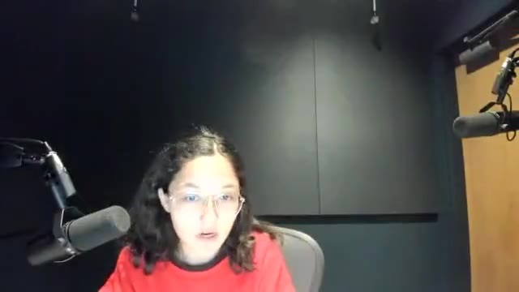
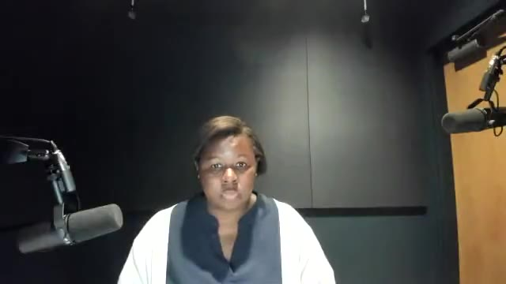
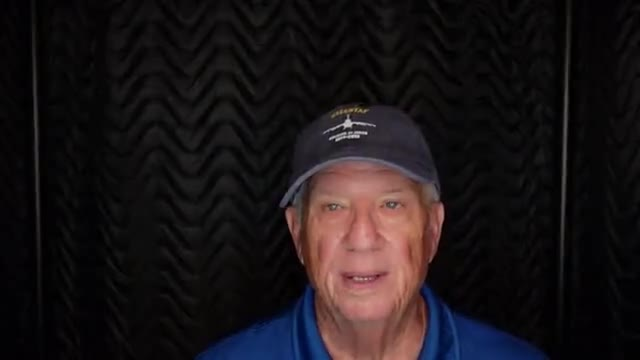
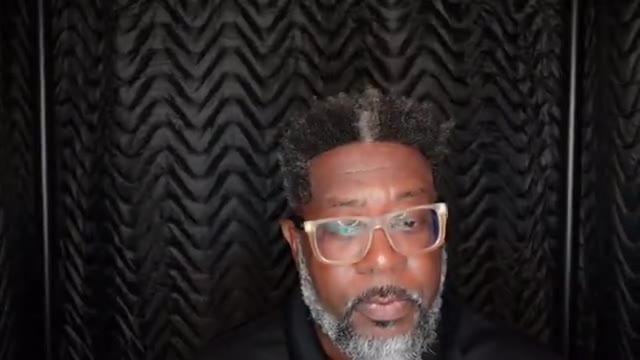
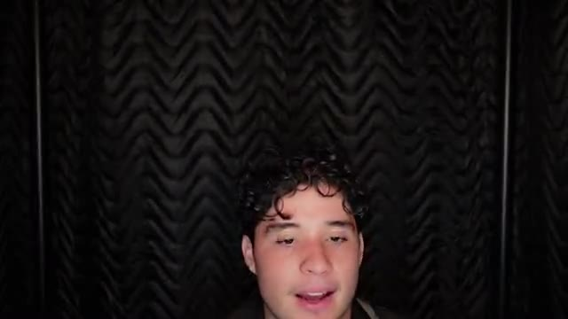
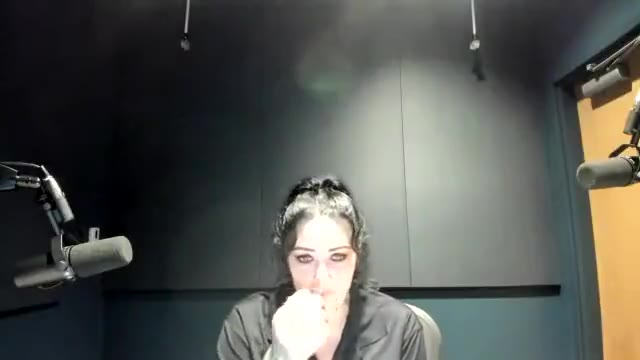

# Oral-history metadata pipeline

Generates video metadata from the six oral-history interviews. The notebook exports `outputs/notebook/UCFremembers911_video_metadata.xlsx`; the legacy script exports `outputs/video_metadata.xlsx`.

The current workflow is the notebook: it generates transcripts from video audio, extracts representative visual evidence from eight frames, and exports descriptions, separate entity facets, five keywords, and up to five supported FAST subjects. Start with [Current notebook workflow](#current-notebook-workflow). The standalone `pipeline.py` workflow below is retained as a legacy alternative.

<!-- BEGIN EXCEL VIDEO EXAMPLE -->
## Video examples — all generated results

All 6 interviews from the eight-frame notebook run. Each example includes every entity facet, all visual-evidence categories, the JSON evidence, description, five keywords, selected FAST subjects, retrieved candidates, and review notes. Click a video preview to open its full MP4 on GitHub; playback includes audio. Ken Lundy also retains the existing inline video attachment. Values are shown as generated, including unresolved transcription details.

- [Danna Arrieta Ventura](#danna-arrieta-ventura)
- [Chereeka Garner](#chereeka-garner)
- [Phillip Jones](#phillip-jones)
- [Ken Lundy](#ken-lundy)
- [Juan Reyes Sierra](#juan-reyes-sierra)
- [Doris Stanley](#doris-stanley)

### Danna Arrieta Ventura

<table>
<tr><th width="40%">Entities and visual evidence</th><th width="60%">Video and generated metadata</th></tr>
<tr>
<td width="40%" valign="top">

<h4>People</h4><ul><li>Donna (speaker’s transcript name; metadata gives Danna)</li><li>Arrieta Ventura (surname listed in metadata)</li><li>Speaker’s mother</li><li>Speaker’s great-aunt</li><li>Middle-school science teacher</li><li>Teacher’s friend</li></ul><h4>Locations</h4><ul><li>Huánuco, Peru</li><li>Lima, Peru</li><li>New York</li><li>United States</li></ul><h4>Organizations</h4><ul><li>UCF Remembers 9/11</li><li>World Trade Center</li></ul><h4>Dates</h4><ul><li>September 11, 2001 (attacks)</li><li>September 11, 2026 (recording date)</li></ul><h4>Themes</h4><ul><li>Family communication across borders</li><li>Inherited family memory</li><li>Radio and television-era news coverage</li><li>Fear and uncertainty</li><li>International and rural impacts</li><li>Aftermath of the attacks</li></ul><h4>Perspective</h4><ul><li>First-person retrospective account combining the speaker’s family history, a great-aunt’s remembered experience of radio coverage, and a story relayed through a former teacher; the speaker does not describe being present at an attack site.</li></ul><h4>Visual evidence</h4><p><strong>Attire and symbols</strong></p><ul><li>98.533 s · V005 · Wears a red top with a black neckline and clear-framed glasses; no legible insignia is visible. (confidence: high; review required: False)</li></ul><p><strong>Artifacts and props</strong></p><ul><li>None recorded</li></ul><p><strong>Activities, expressions and gaze</strong></p><ul><li>14.067 s · V001 · Faces forward with mouth slightly open, as if speaking; gaze is directed toward the camera area. (confidence: medium; review required: False)</li><li>42.233 s · V003 · Leans forward and looks slightly downward, mouth open. (confidence: high; review required: False)</li><li>142 s · V007 · Tilts head down and directs gaze below the camera; eyes appear closed or lowered. (confidence: high; review required: False)</li><li>154.867 s · V008 · Raises gaze to face forward again, with a neutral visible expression. (confidence: high; review required: False)</li></ul>

</td>
<td width="60%" valign="top">

<h3>Danna Arrieta Ventura</h3><p>169 seconds · 8 sampled frames</p><p><a href="examples/videos/danna-arrieta-ventura.mp4"></a></p><p><a href="examples/videos/danna-arrieta-ventura.mp4">Play full video with audio</a> · Compressed viewing copy; original duration retained.</p><h4>Generated description</h4><p>The speaker introduces herself in the transcript as “Donna,” while the supplied metadata gives “Danna”; her surname is listed in the metadata as Arrieta Ventura. In this UCF Remembers 9/11 recording, dated September 11, 2026, she reflects on family connections to the September 11, 2001 attacks and their aftermath. She recounts that her mother, an immigrant from Peru, was studying in high school in New York in 2001 and could communicate with family in Huánuco only every week or two. The speaker relays her great-aunt’s account of listening to radio coverage in Lima and fearing for the mother while communication was unavailable. She also recounts a story from her middle-school science teacher about his friend, who worked at or near the World Trade Center and was surrounded and hidden by coworkers and friends while walking in New York in the weeks after the attacks. The account emphasizes fear and the attacks’ cultural effects in the United States and internationally, including in rural areas.</p><h4>Keywords</h4><ul><li>Family communication across borders</li><li>Peruvian family memories</li><li>Radio coverage and fear</li><li>International impact of 9/11</li><li>Aftermath in New York</li></ul><h4>Selected FAST subjects</h4><ul><li>September 11 Terrorist Attacks (2001)</li><li>Immigrants--Family relationships</li><li>Collective memory</li><li>Communication, International--Social aspects</li></ul><h4>Review status</h4><p>needs_review</p><h4>Review issues</h4><ul><li>Description sentence 1: The transcript says “Donna,” while metadata lists “Danna”; the supplied data does not establish that these are the same person, so avoid presenting the discrepancy as a resolved identity.</li><li>Description sentence 4 overstates the chronology: the aunt feared for the mother during a week or two without communication, but the excerpt does not establish that communication was unavailable specifically throughout the attacks or that the mother was separated from all relatives.</li><li>Keyword “Peruvian family memories” is weakly supported: the account concerns the aunt’s reported experience and the speaker’s family ties, not sustained recollections or memories from family members in Peru.</li><li>FAST heading “Collective memory” is weakly relevant: the speaker urges remembering the attacks, but the account is primarily personal and family recollection rather than collective memory as a sustained subject.</li><li>FAST heading “Communication, International--Social aspects” is weakly relevant: limited international contact is discussed, but the account focuses on its role in family anxiety rather than international communication as a broader social topic.</li></ul><h4>Uncertainties</h4><ul><li>The speaker’s first name differs between the transcript (“Donna”) and supplied metadata (“Danna”); the discrepancy is unresolved.</li><li>The transcript does not clearly establish the teacher’s friend’s identity or what the phrase “who was a hijab” means; no attire or identity inference is made.</li></ul>

</td>
</tr>
</table>

<details><summary>Visual evidence JSON</summary>

```json
{
  "visual_observations": [
    {
      "frame_id": "V005",
      "category": "attire_and_symbols",
      "observation": "Wears a red top with a black neckline and clear-framed glasses; no legible insignia is visible.",
      "confidence": "high",
      "timestamp_seconds": 98.533,
      "review_required": false
    },
    {
      "frame_id": "V001",
      "category": "activities_and_emotional_moments",
      "observation": "Faces forward with mouth slightly open, as if speaking; gaze is directed toward the camera area.",
      "confidence": "medium",
      "timestamp_seconds": 14.067,
      "review_required": false
    },
    {
      "frame_id": "V003",
      "category": "activities_and_emotional_moments",
      "observation": "Leans forward and looks slightly downward, mouth open.",
      "confidence": "high",
      "timestamp_seconds": 42.233,
      "review_required": false
    },
    {
      "frame_id": "V007",
      "category": "activities_and_emotional_moments",
      "observation": "Tilts head down and directs gaze below the camera; eyes appear closed or lowered.",
      "confidence": "high",
      "timestamp_seconds": 142.0,
      "review_required": false
    },
    {
      "frame_id": "V008",
      "category": "activities_and_emotional_moments",
      "observation": "Raises gaze to face forward again, with a neutral visible expression.",
      "confidence": "high",
      "timestamp_seconds": 154.867,
      "review_required": false
    }
  ]
}
```

</details>

<details><summary>All retrieved FAST candidates</summary>

<ul><li>1. News recordings (fst01037025)</li><li>2. Radio broadcasting and war (fst01087275)</li><li>3. Family secrets (fst01737651)</li><li>4. Television news anchors (fst01146963)</li><li>5. Immigrants--Family relationships (fst00967734)</li><li>6. Memory on television (fst01749943)</li><li>7. Symbolic Drawing of the Family Space (fst01140739)</li><li>8. News radio stations (fst01037024)</li><li>9. Multilingual communication (fst01749982)</li><li>10. Television broadcasting of news--U.S. states (fst01146813)</li><li>11. Broadcast journalism--Technological innovations (fst00839182)</li><li>12. Television broadcasting of news--Study and teaching (fst01146811)</li><li>13. Television broadcasting of news--Law and legislation (fst01146798)</li><li>14. Television broadcasting of news--Philosophy (fst01146803)</li><li>15. Intergenerational communication (fst00976250)</li><li>16. United States--Territory of the United States, South of the River Ohio (fst01236609)</li><li>17. Television broadcasting of news--Management (fst01146799)</li><li>18. Television broadcasting of news--Awards (fst01146790)</li><li>19. Early memories (fst00900644)</li><li>20. Television broadcasting of news--Standards (fst01146810)</li><li>21. Television broadcasting of news--Evaluation (fst01146794)</li><li>22. Collective memory (fst01739814)</li><li>23. United States--Center Hill Metabentonite (fst01265481)</li><li>24. Collective memory and television (fst02021907)</li><li>25. Television broadcasting of news--Employees (fst01146793)</li><li>26. Television broadcasting of news--Research (fst01146807)</li><li>27. Television broadcasting of news--Public opinion (fst01146806)</li><li>28. United States--Northwest boundary of the United States (fst01242544)</li><li>29. Communication, International--Social aspects (fst00870340)</li><li>30. Rural extension (fst01101619)</li></ul>

</details>

[Full generated result and supporting evidence](examples/data/danna-arrieta-ventura.json).

### Chereeka Garner

<table>
<tr><th width="40%">Entities and visual evidence</th><th width="60%">Video and generated metadata</th></tr>
<tr>
<td width="40%" valign="top">

<h4>People</h4><ul><li>Sharika Garner (speaker, as introduced in the transcript)</li><li>Garner’s father (unnamed)</li></ul><h4>Locations</h4><ul><li>John C. Hitt Library, UCF</li><li>University High School, Orlando, Florida</li><li>School gym, courtyard, classroom, locker room, and attendance office (as recalled)</li></ul><h4>Organizations</h4><ul><li>University of Central Florida (UCF)</li><li>University High School</li><li>Night Tales Project</li><li>UCF Remembers 9/11</li></ul><h4>Dates</h4><ul><li>September 11, 2001 (historical event and recollection date)</li><li>September 11, 2026 (recording date)</li></ul><h4>Themes</h4><ul><li>Student recollections of September 11, 2001</li><li>Television news coverage of the World Trade Center attack</li><li>School response and student departures</li><li>Family communication and understanding the event’s magnitude</li></ul><h4>Perspective</h4><ul><li>First-person recollection by a high school senior; distinguishes her school experience and television viewing from direct presence at an attack site.</li></ul><h4>Visual evidence</h4><p><strong>Attire and symbols</strong></p><ul><li>6 s · V001 · The seated speaker wears a white outer layer over a dark navy top with a folded collar; no legible insignia is visible. (confidence: high; review required: False)</li></ul><p><strong>Artifacts and props</strong></p><ul><li>6 s · V001 · A large foam-covered microphone on an articulated arm is visible at the left; another microphone is partly visible at the upper right. (confidence: high; review required: False)</li></ul><p><strong>Activities, expressions and gaze</strong></p><ul><li>50 s · V003 · The speaker looks downward with eyes partly closed and mouth open mid-speech. (confidence: high; review required: False)</li><li>82.333 s · V004 · The speaker faces forward with eyes widened and mouth slightly open while speaking. (confidence: high; review required: False)</li><li>192.1 s · V006 · The speaker&#x27;s brow is furrowed and eyes narrowed, with mouth open mid-speech. (confidence: high; review required: False)</li></ul>

</td>
<td width="60%" valign="top">

<h3>Chereeka Garner</h3><p>329 seconds · 8 sampled frames</p><p><a href="examples/videos/chereeka-garner.mp4"></a></p><p><a href="examples/videos/chereeka-garner.mp4">Play full video with audio</a> · Compressed viewing copy; original duration retained.</p><h4>Generated description</h4><p>In an interview recorded at UCF’s John C. Hitt Library on September 11, 2026, the speaker introduces herself as Sharika Garner and identifies the interview as part of the Night Tales Project. Garner recalls being a senior at University High School in Orlando, across the street from UCF, on September 11, 2001. She describes arriving early for the senior class panoramic photograph, then waiting in the courtyard before walking to a class where students were watching television coverage of the World Trade Center attack. Confused by the quiet and events at school, she called her father, who told her she could go home; she later recalls the long line of parents signing students out. Garner says she stayed at school until the end of the day and understood the magnitude of the events more fully after returning home and finding that her father had left work early. The account is a personal recollection of school experiences and television news coverage, with no claim that Garner was physically present at an attack site.</p><h4>Keywords</h4><ul><li>high school student recollections</li><li>September 11 television coverage</li><li>school dismissal and parent sign-outs</li><li>family communication during crisis</li><li>UCF Remembers 9/11 oral histories</li></ul><h4>Selected FAST subjects</h4><ul><li>September 11 Terrorist Attacks (2001)</li><li>September 11 Terrorist Attacks, 2001, on television</li></ul><h4>Review status</h4><p>passed_automated_review</p><h4>Review issues</h4><ul><li>None recorded</li></ul><h4>Uncertainties</h4><ul><li>The speaker introduces herself as “Sharika Garner” in T001, while C001 lists “Chereeka Garner” and gives a filename using Chereeka; the speaker’s name requires verification.</li><li>C001 records the date as 2026-09-11, consistent with the spoken date in T001; the interview date is distinct from the historical events recalled from 2001.</li><li>No specific names are provided for Garner’s father, teachers, or classmates.</li></ul>

</td>
</tr>
</table>

<details><summary>Visual evidence JSON</summary>

```json
{
  "visual_observations": [
    {
      "frame_id": "V001",
      "category": "attire_and_symbols",
      "observation": "The seated speaker wears a white outer layer over a dark navy top with a folded collar; no legible insignia is visible.",
      "confidence": "high",
      "timestamp_seconds": 6.0,
      "review_required": false
    },
    {
      "frame_id": "V001",
      "category": "artifacts_and_props",
      "observation": "A large foam-covered microphone on an articulated arm is visible at the left; another microphone is partly visible at the upper right.",
      "confidence": "high",
      "timestamp_seconds": 6.0,
      "review_required": false
    },
    {
      "frame_id": "V003",
      "category": "activities_and_emotional_moments",
      "observation": "The speaker looks downward with eyes partly closed and mouth open mid-speech.",
      "confidence": "high",
      "timestamp_seconds": 50.0,
      "review_required": false
    },
    {
      "frame_id": "V004",
      "category": "activities_and_emotional_moments",
      "observation": "The speaker faces forward with eyes widened and mouth slightly open while speaking.",
      "confidence": "high",
      "timestamp_seconds": 82.333,
      "review_required": false
    },
    {
      "frame_id": "V006",
      "category": "activities_and_emotional_moments",
      "observation": "The speaker's brow is furrowed and eyes narrowed, with mouth open mid-speech.",
      "confidence": "high",
      "timestamp_seconds": 192.1,
      "review_required": false
    }
  ]
}
```

</details>

<details><summary>All retrieved FAST candidates</summary>

<ul><li>1. September 11 Terrorist Attacks (2001) in motion pictures (fst01907196)</li><li>2. September 11 Terrorist Attacks (2001) in mass media (fst01907195)</li><li>3. September 11 Terrorist Attacks (2001) in literature (fst01907194)</li><li>4. September 11 Terrorist Attacks, 2001, in comics (fst02060917)</li><li>5. September 11 Terrorist Attacks, 2001, on television (fst01747281)</li><li>6. Florida--John F. Kennedy Space Center Region (fst01308005)</li><li>7. Library publications (fst00997882)</li><li>8. Student library assistants (fst01135935)</li><li>9. September (fst01112793)</li><li>10. Washington (D.C.)--John F. Kennedy Center Plaza (fst01327677)</li><li>11. Student library assistants--Training of (fst01135936)</li><li>12. News recordings (fst01037025)</li><li>13. Florida--Florida State University Reservation (fst01882094)</li><li>14. Florida--Orlando--International Drive (fst01320716)</li><li>15. Florida--Orlando (fst01204036)</li><li>16. Florida--North Orlando (fst01216436)</li><li>17. Florida--Orlando--Pine Castle (fst01313729)</li><li>18. Florida--Orlando Metropolitan Area (fst01343966)</li><li>19. Neighborhood Information Center Project (fst01035615)</li><li>20. Florida--Orlando Region (fst01343967)</li><li>21. Florida--Orlando Suburban Area (fst01343968)</li><li>22. Florida--Orlando--Williamsburg (fst01323268)</li><li>23. Student participation in administration (fst01135969)</li><li>24. Florida--Center Hill (fst01215369)</li><li>25. End of the world (fst00909634)</li><li>26. High school students&#x27; writings, American (fst00956238)</li><li>27. High school student activities (fst00956172)</li><li>28. High school students--Family relationships (fst00956194)</li><li>29. Locker hooking (fst01001682)</li><li>30. Public school closings (fst01082940)</li></ul>

</details>

[Full generated result and supporting evidence](examples/data/chereeka-garner.json).

### Phillip Jones

<table>
<tr><th width="40%">Entities and visual evidence</th><th width="60%">Video and generated metadata</th></tr>
<tr>
<td width="40%" valign="top">

<h4>People</h4><ul><li>Phillip (Phil) Jones</li><li>Dwayne Williams</li></ul><h4>Locations</h4><ul><li>Shaw Air Force Base</li><li>Egypt</li><li>United Arab Emirates</li><li>Sumter, South Carolina</li><li>Pentagon</li><li>Middle East</li></ul><h4>Organizations</h4><ul><li>U.S. CENTAF</li><li>U.S. Air Force</li><li>U.S. Army</li></ul><h4>Dates</h4><ul><li>September 11, 2001 — collection event</li><li>September 11, 2026 — recording date</li><li>About 90 days after September 11, 2001, until around Thanksgiving — period Jones describes working without a day off</li></ul><h4>Themes</h4><ul><li>Personal account of September 11</li><li>Television coverage of the attacks</li><li>Military planning and deployment logistics</li><li>Support and evacuation of personnel stranded abroad</li><li>Remembrance of a friend killed</li></ul><h4>Perspective</h4><ul><li>First-person recollection by a retired Air Force colonel and former U.S. CENTAF deputy A5; includes his account of television coverage and military response, and a personal memory of a friend who perished.</li></ul><h4>Visual evidence</h4><p><strong>Attire and symbols</strong></p><ul><li>25.367 s · V001 · At 25.367s, he wears a royal-blue collared shirt and a dark navy baseball cap embroidered in yellow with “USCENTAF,” above a white aircraft graphic and smaller white lettering including “COLONEL PJ JONES.” A thin chain is visible at the neckline. (confidence: high; review required: False)</li></ul><p><strong>Artifacts and props</strong></p><ul><li>None recorded</li></ul><p><strong>Activities, expressions and gaze</strong></p><ul><li>76.133 s · V003 · At 76.133s, his mouth is open and his gaze is angled slightly downward. (confidence: high; review required: False)</li><li>104 s · V004 · At 104.0s, his eyes are closed and his mouth is closed. (confidence: high; review required: False)</li><li>177.7 s · V006 · At 177.7s, his eyes are closed and his mouth is open, with teeth visible. (confidence: high; review required: False)</li><li>228.467 s · V007 · At 228.467s, his gaze is lowered and his mouth is slightly open. (confidence: high; review required: False)</li></ul>

</td>
<td width="60%" valign="top">

<h3>Phillip Jones</h3><p>305 seconds · 8 sampled frames</p><p><a href="examples/videos/phillip-jones.mp4"></a></p><p><a href="examples/videos/phillip-jones.mp4">Play full video with audio</a> · Compressed viewing copy; original duration retained.</p><h4>Generated description</h4><p>Phillip (Phil) Jones identifies himself as a retired Air Force colonel who served as deputy A5 at U.S. CENTAF at Shaw Air Force Base during the September 11 attacks. He recalls watching television at work as the first and second planes hit, then sending office staff and conference attendees home because he feared their headquarters might be a target. Jones describes coordinating support for personnel in Egypt and arranging military transport for them and conference participants from the UAE after commercial flights stopped. He says he worked on transportation for forces deploying to the Middle East and had no day off for about 90 days, until around Thanksgiving. Jones closes by remembering his friend Dwayne Williams, an Army major he had been stationed with in Egypt, who perished; this is a personal recollection, not a claim that Jones was at an attack site. The interview was recorded on September 11, 2026; the collection identifies its subject event as the September 11 terrorist attacks of 2001.</p><h4>Keywords</h4><ul><li>September 11 personal recollections</li><li>Military response planning</li><li>Deployment logistics to the Middle East</li><li>Evacuation and support for personnel abroad</li><li>Television coverage of the attacks</li></ul><h4>Selected FAST subjects</h4><ul><li>September 11 Terrorist Attacks (2001)</li><li>Transportation, Military--Planning</li><li>South Carolina--Shaw Air Force Base</li></ul><h4>Review status</h4><p>needs_review</p><h4>Review issues</h4><ul><li>“Television coverage of the attacks” is weak as a keyword: the transcript mentions watching the planes hit only briefly, rather than sustaining coverage of television or media.</li></ul><h4>Uncertainties</h4><ul><li>No redacted details are present in the supplied transcript spans.</li><li>The transcript does not specify an exact date for the conference, the personnel movements, or Jones’s return to a day off; it places the latter around Thanksgiving.</li></ul>

</td>
</tr>
</table>

<details><summary>Visual evidence JSON</summary>

```json
{
  "visual_observations": [
    {
      "frame_id": "V001",
      "category": "attire_and_symbols",
      "observation": "At 25.367s, he wears a royal-blue collared shirt and a dark navy baseball cap embroidered in yellow with “USCENTAF,” above a white aircraft graphic and smaller white lettering including “COLONEL PJ JONES.” A thin chain is visible at the neckline.",
      "confidence": "high",
      "timestamp_seconds": 25.367,
      "review_required": false
    },
    {
      "frame_id": "V003",
      "category": "activities_and_emotional_moments",
      "observation": "At 76.133s, his mouth is open and his gaze is angled slightly downward.",
      "confidence": "high",
      "timestamp_seconds": 76.133,
      "review_required": false
    },
    {
      "frame_id": "V004",
      "category": "activities_and_emotional_moments",
      "observation": "At 104.0s, his eyes are closed and his mouth is closed.",
      "confidence": "high",
      "timestamp_seconds": 104.0,
      "review_required": false
    },
    {
      "frame_id": "V006",
      "category": "activities_and_emotional_moments",
      "observation": "At 177.7s, his eyes are closed and his mouth is open, with teeth visible.",
      "confidence": "high",
      "timestamp_seconds": 177.7,
      "review_required": false
    },
    {
      "frame_id": "V007",
      "category": "activities_and_emotional_moments",
      "observation": "At 228.467s, his gaze is lowered and his mouth is slightly open.",
      "confidence": "high",
      "timestamp_seconds": 228.467,
      "review_required": false
    }
  ]
}
```

</details>

<details><summary>All retrieved FAST candidates</summary>

<ul><li>1. South Carolina--Shaw Air Force Base (fst01219335)</li><li>2. Arizona--Williams Air Force Base (fst01209443)</li><li>3. South Dakota--Ellsworth Air Force Base (fst01271967)</li><li>4. Texas--Dyess Air Force Base (fst01214180)</li><li>5. North Carolina--Pope Air Force Base (fst01277322)</li><li>6. Texas--Randolph Air Force Base (fst01213140)</li><li>7. South Carolina--Myrtle Beach Air Force Base (fst01238171)</li><li>8. California--Vandenberg Air Force Base (fst01210320)</li><li>9. Florida--Tyndall Air Force Base (fst01206061)</li><li>10. Transportation, Military--Planning (fst01155405)</li><li>11. North Carolina--Seymour Johnson Air Force Base (fst01927912)</li><li>12. South Carolina--Charleston Army Air Field (fst01879374)</li><li>13. Texas--Kelly Air Force Base (fst01212914)</li><li>14. Texas--Brooks Air Force Base (fst01213141)</li><li>15. Georgia--Robins Air Force Base (fst01204249)</li><li>16. South Africa--Swartkop Air Force Base (fst01877526)</li><li>17. California--Norton Air Force Base (fst01212905)</li><li>18. Georgia--Moody Air Force Base (fst01204246)</li><li>19. Colorado--Lowry Air Force Base (fst01213053)</li><li>20. Nevada--Nellis Air Force Base (fst01203478)</li><li>21. Louisiana--DeRidder Army Air Base (fst01889362)</li><li>22. South Carolina--Sumter (fst01216215)</li><li>23. South Carolina--Sumter Junction (fst01263183)</li><li>24. Virginia--Langley Air Force Base (fst01212030)</li><li>25. Utah--Hill Air Force Base (fst01207125)</li><li>26. California--Beale Air Force Base (fst01206542)</li><li>27. South Carolina--Sumter County (fst01211788)</li><li>28. Arizona--Luke Air Force Base (fst01207641)</li><li>29. Personal archives (fst01058566)</li><li>30. United Arab Emirates--ʻAjmān (fst01209210)</li></ul>

</details>

[Full generated result and supporting evidence](examples/data/phillip-jones.json).

### Ken Lundy

<table>
<tr><th width="40%">Entities and visual evidence</th><th width="60%">Video and generated metadata</th></tr>
<tr>
<td width="40%" valign="top">

<h4>People</h4><ul><li>Ken (surname spelling uncertain)</li><li>Ken’s wife</li><li>Ken’s friend</li></ul><h4>Locations</h4><ul><li>UCF John C. Hitt Library</li><li>Grand Rapids, Michigan</li><li>New York City</li><li>World Trade Center</li></ul><h4>Organizations</h4><ul><li>UCF</li><li>Knights Tales Project</li><li>Steelcase</li><li>Social Security</li></ul><h4>Dates</h4><ul><li>September 11, 2026 (recording date)</li><li>September 11, 2001 (event date)</li><li>Labor Day 2001 (prior visit)</li></ul><h4>Themes</h4><ul><li>September 11, 2001 attacks</li><li>work and relocation</li><li>World Trade Center visit before the attacks</li><li>family communication</li><li>remembrance and healing</li></ul><h4>Perspective</h4><ul><li>Personal recollection of watching events unfold at Steelcase headquarters in Grand Rapids, combined with memories of a prior World Trade Center visit; the account does not describe being at an attack site during the attacks.</li></ul><h4>Visual evidence</h4><p><strong>Attire and symbols</strong></p><ul><li>15.567 s · V001 · Wearing a black collared top and large translucent, pale-framed glasses with black temples; a small white mark is visible on one temple but is not legible. (confidence: high; review required: False)</li></ul><p><strong>Artifacts and props</strong></p><ul><li>None recorded</li></ul><p><strong>Activities, expressions and gaze</strong></p><ul><li>46.733 s · V002 · Mouth open mid-speech, facing mostly forward with gaze slightly to the side. (confidence: high; review required: False)</li><li>158 s · V006 · Gaze lowered and lips closed; no hand gesture is visible. (confidence: high; review required: False)</li><li>171.367 s · V007 · Mouth open mid-speech, with gaze angled slightly downward to the side. (confidence: high; review required: False)</li></ul>

</td>
<td width="60%" valign="top">

<h3>Ken Lundy</h3><p>187 seconds · 8 sampled frames</p><p><a href="examples/videos/ken-lundy.mp4"></a></p><p><a href="examples/videos/ken-lundy.mp4">Play full video with audio</a> · Compressed viewing copy; original duration retained.</p>

https://github.com/user-attachments/assets/56694318-b34f-448b-ae63-0d945b35f1cf

<h4>Generated description</h4><p>Ken introduces himself as recording an interview at UCF’s John C. Hitt Library for the Knights Tales Project on September 11, 2026, the 25th anniversary of 9/11. He recalls working for Steelcase, whose headquarters was in Grand Rapids, Michigan, while his territory was New York City. Before the attacks, he and his wife had traveled to the New York City area over Labor Day 2001 to seek employment and housing; he says his first visit to the World Trade Center towers was during that trip. He describes being at Steelcase headquarters in Grand Rapids on September 11, 2001, watching events unfold there, and being unable to reach his wife, who was working for Social Security. He says he later met his wife at home in Grand Rapids and recalls meeting a friend in the World Trade Center shopping area during his earlier visit. He reflects on the people who worked in the World Trade Center, remembers the victims, and expresses hope and prayer for healing. In the supplied video frames, the speaker wears a dark collared top and pale-framed glasses; frames also show him speaking and, at one moment, looking downward.</p><h4>Keywords</h4><ul><li>September 11, 2001 attacks</li><li>Grand Rapids recollections</li><li>World Trade Center visit before the attacks</li><li>family communication during the attacks</li><li>remembrance and healing</li></ul><h4>Selected FAST subjects</h4><ul><li>September 11 Terrorist Attacks (2001)</li><li>Victims of terrorism</li></ul><h4>Review status</h4><p>needs_review</p><h4>Review issues</h4><ul><li>The keyword “family communication during the attacks” overstates the coverage: the transcript briefly mentions being unable to reach his wife and later meeting her at home, rather than sustained discussion of family communication.</li><li>The FAST heading “Victims of terrorism” is weakly relevant as a selected heading: victims are mentioned briefly in closing remarks, while the interview primarily recounts the speaker’s own experience. The rationale’s claim that victims are a central topic is unsupported.</li></ul><h4>Uncertainties</h4><ul><li>The transcript identifies the speaker as “Ken Landy,” while the supplied metadata gives the surname as “Lundy”; the surname spelling is unresolved.</li><li>The transcript ends mid-sentence after the speaker says “later on that afternoon,” so the omitted continuation is unknown.</li></ul>

</td>
</tr>
</table>

<details><summary>Visual evidence JSON</summary>

```json
{
  "visual_observations": [
    {
      "frame_id": "V001",
      "category": "attire_and_symbols",
      "observation": "Wearing a black collared top and large translucent, pale-framed glasses with black temples; a small white mark is visible on one temple but is not legible.",
      "confidence": "high",
      "timestamp_seconds": 15.567,
      "review_required": false
    },
    {
      "frame_id": "V002",
      "category": "activities_and_emotional_moments",
      "observation": "Mouth open mid-speech, facing mostly forward with gaze slightly to the side.",
      "confidence": "high",
      "timestamp_seconds": 46.733,
      "review_required": false
    },
    {
      "frame_id": "V006",
      "category": "activities_and_emotional_moments",
      "observation": "Gaze lowered and lips closed; no hand gesture is visible.",
      "confidence": "high",
      "timestamp_seconds": 158.0,
      "review_required": false
    },
    {
      "frame_id": "V007",
      "category": "activities_and_emotional_moments",
      "observation": "Mouth open mid-speech, with gaze angled slightly downward to the side.",
      "confidence": "high",
      "timestamp_seconds": 171.367,
      "review_required": false
    }
  ]
}
```

</details>

<details><summary>All retrieved FAST candidates</summary>

<ul><li>1. September 11 Terrorist Attacks (2001) in motion pictures (fst01907196)</li><li>2. Community college libraries (fst00870710)</li><li>3. Washington (D.C.)--John F. Kennedy Center Plaza (fst01327677)</li><li>4. September 11 Terrorist Attacks (2001) in mass media (fst01907195)</li><li>5. September 11 Terrorist Attacks, 2001, in comics (fst02060917)</li><li>6. Victims of terrorism (fst01166347)</li><li>7. September (fst01112793)</li><li>8. New York (State)--Guilderland Center (fst01229406)</li><li>9. September 11 Terrorist Attacks (2001) in literature (fst01907194)</li><li>10. Family social work (fst00920516)</li><li>11. September 11 Terrorist Attacks, 2001, on television (fst01747281)</li><li>12. Communication in families (fst01728100)</li><li>13. New York (State)--Tioga Center (fst01881448)</li><li>14. Public utilities, Relocation of (fst01083242)</li><li>15. Family social work--Planning (fst00920522)</li><li>16. Middle class--Relocation (fst01020466)</li><li>17. Work and family (fst01180235)</li><li>18. Healing in art (fst00952727)</li><li>19. New York (State)--Plainfield Center (fst01884429)</li><li>20. Family social work--Management (fst00920521)</li><li>21. New York (State)--Center Moriches (fst01257864)</li><li>22. Family social work--Evaluation (fst00920518)</li><li>23. Skyscrapers--Security measures (fst01120300)</li><li>24. Work and family--Social aspects (fst01180245)</li><li>25. Social security--Field work (fst01123105)</li><li>26. New York (State)--Orangeville Center (fst01299066)</li><li>27. Family social work--Standards (fst00920524)</li><li>28. Family social work--Research (fst00920523)</li><li>29. Family social work--Study and teaching (fst00920525)</li><li>30. New York State Social Studies Test (fst01036779)</li></ul>

</details>

[Full generated result and supporting evidence](examples/data/ken-lundy.json).

### Juan Reyes Sierra

<table>
<tr><th width="40%">Entities and visual evidence</th><th width="60%">Video and generated metadata</th></tr>
<tr>
<td width="40%" valign="top">

<h4>People</h4><ul><li>Juan Reyes Sierra</li><li>Juan Reyes Sierra’s father</li><li>President Bush</li></ul><h4>Locations</h4><ul><li>Sarasota, Florida</li><li>Longboat Key, Florida</li><li>Colony Beach and Resort</li><li>Booker Elementary School</li><li>Sarasota Airport</li></ul><h4>Organizations</h4><ul><li>University of Central Florida (UCF)</li><li>UCF Remembers 9/11</li></ul><h4>Dates</h4><ul><li>September 11, 2001 (collection event date)</li><li>September 11, 2026 (recording date)</li></ul><h4>Themes</h4><ul><li>inherited family memory</li><li>September 11, 2001</li><li>presidential visit</li><li>hotel logistics and brunch preparations</li><li>airport shutdown and fighter jets</li><li>family pride</li></ul><h4>Perspective</h4><ul><li>Juan Reyes Sierra recounts his father’s experience and reflections; Reyes Sierra states that he was not born at the time. The account is not presented as his firsthand experience.</li></ul><h4>Visual evidence</h4><p><strong>Attire and symbols</strong></p><ul><li>62.5 s · V004 · He wears a dark top or jacket with a light gray-beige strap or trim visible over one shoulder; no legible insignia is visible. (confidence: medium; review required: False)</li></ul><p><strong>Artifacts and props</strong></p><ul><li>None recorded</li></ul><p><strong>Activities, expressions and gaze</strong></p><ul><li>22 s · V002 · Facing forward, he looks toward the camera with his mouth slightly open. (confidence: high; review required: False)</li><li>76 s · V005 · He turns his face down and to one side, with his gaze lowered. (confidence: high; review required: False)</li><li>87.5 s · V006 · He bows his head, looking down; only the upper portion of his face is visible near the lower edge of the frame. (confidence: high; review required: False)</li><li>137.5 s · V008 · Facing forward again, he looks slightly upward with his mouth open. (confidence: high; review required: False)</li></ul>

</td>
<td width="60%" valign="top">

<h3>Juan Reyes Sierra</h3><p>150 seconds · 8 sampled frames</p><p><a href="examples/videos/juan-reyes-sierra.mp4"></a></p><p><a href="examples/videos/juan-reyes-sierra.mp4">Play full video with audio</a> · Compressed viewing copy; original duration retained.</p><h4>Generated description</h4><p>Juan Reyes Sierra, identified in the recording context as a UCF senior, shares his father’s account of September 11, 2001; Reyes Sierra says he was not yet born at the time. His father was a manager at the Colony Beach and Resort in Longboat Key, Florida, and was with President Bush there on the morning of September 11. Reyes Sierra says his father was responsible for logistics and recalled that they spent about a week preparing a brunch menu for Bush. His father took a photograph with Bush, which Reyes Sierra refers to while telling the story. Reyes Sierra recounts his father’s report that Sarasota Airport was shut down and that fighter jets were present; he says people thought the president might be targeted. The account is presented as inherited family memory, not as Reyes Sierra’s personal experience of the events. The recording context gives a recording date of September 11, 2026, and identifies the collection as UCF Remembers 9/11.</p><h4>Keywords</h4><ul><li>September 11, 2001 family memory</li><li>Presidential visit to Sarasota</li><li>Hotel logistics and brunch preparations</li><li>Sarasota Airport shutdown</li><li>Fighter jets and presidential security concerns</li></ul><h4>Selected FAST subjects</h4><ul><li>September 11 Terrorist Attacks (2001)</li><li>Florida--Sarasota</li></ul><h4>Review status</h4><p>passed_automated_review</p><h4>Review issues</h4><ul><li>None recorded</li></ul><h4>Uncertainties</h4><ul><li>The father’s name is not provided.</li><li>The transcript does not identify who prepared the brunch menu.</li><li>The transcript does not specify the date or circumstances of the photograph with President Bush.</li><li>The transcript reports beliefs about a possible threat to the president but does not establish the threat’s nature or whether it was confirmed.</li></ul>

</td>
</tr>
</table>

<details><summary>Visual evidence JSON</summary>

```json
{
  "visual_observations": [
    {
      "frame_id": "V004",
      "category": "attire_and_symbols",
      "observation": "He wears a dark top or jacket with a light gray-beige strap or trim visible over one shoulder; no legible insignia is visible.",
      "confidence": "medium",
      "timestamp_seconds": 62.5,
      "review_required": false
    },
    {
      "frame_id": "V002",
      "category": "activities_and_emotional_moments",
      "observation": "Facing forward, he looks toward the camera with his mouth slightly open.",
      "confidence": "high",
      "timestamp_seconds": 22.0,
      "review_required": false
    },
    {
      "frame_id": "V005",
      "category": "activities_and_emotional_moments",
      "observation": "He turns his face down and to one side, with his gaze lowered.",
      "confidence": "high",
      "timestamp_seconds": 76.0,
      "review_required": false
    },
    {
      "frame_id": "V006",
      "category": "activities_and_emotional_moments",
      "observation": "He bows his head, looking down; only the upper portion of his face is visible near the lower edge of the frame.",
      "confidence": "high",
      "timestamp_seconds": 87.5,
      "review_required": false
    },
    {
      "frame_id": "V008",
      "category": "activities_and_emotional_moments",
      "observation": "Facing forward again, he looks slightly upward with his mouth open.",
      "confidence": "high",
      "timestamp_seconds": 137.5,
      "review_required": false
    }
  ]
}
```

</details>

<details><summary>All retrieved FAST candidates</summary>

<ul><li>1. September 11 Terrorist Attacks, 2001, in comics (fst02060917)</li><li>2. September 11 Terrorist Attacks (2001) in literature (fst01907194)</li><li>3. September 11 Terrorist Attacks (2001) in mass media (fst01907195)</li><li>4. September 11 Terrorist Attacks, 2001, on television (fst01747281)</li><li>5. September 11 Terrorist Attacks (2001) in motion pictures (fst01907196)</li><li>6. Reggiane Re.2001 (Fighter plane) (fst01910112)</li><li>7. Westcott Gate (Tallahassee, Fla.) (fst01762842)</li><li>8. Florida--Pompano Beach (fst01215852)</li><li>9. Florida--Sarasota Metropolitan Area (fst01343986)</li><li>10. Florida--Sarasota Bay Watershed (fst01877821)</li><li>11. Florida--Manasota Key (fst01308766)</li><li>12. Florida--Sarasota Bay Region (fst01343985)</li><li>13. Florida--Sarasota (fst01207248)</li><li>14. September (fst01112793)</li><li>15. Florida--Sarasota Region (fst01343987)</li><li>16. Caudron R.11 (Fighter plane) (fst01909358)</li><li>17. Florida--Sarasota County (fst01214943)</li><li>18. Florida--Vero Beach (fst01213563)</li><li>19. Florida--Perdido Key (fst01307560)</li><li>20. Florida--Siesta Key (fst01215775)</li><li>21. Florida--Florida State University Reservation (fst01882094)</li><li>22. Family records (fst00920467)</li><li>23. Florida language (fst00927686)</li><li>24. Florida--Egmont Key (fst01889144)</li><li>25. Bok Tower (Lake Wales, Fla.) (fst00835658)</li><li>26. Florida--Madeira Beach (fst01215210)</li><li>27. Florida--Saint Armands Key (fst01242110)</li><li>28. Florida--Cocoa Beach (fst01212556)</li><li>29. Florida--Dania Beach (fst01216013)</li><li>30. Florida--Key West (fst01207829)</li></ul>

</details>

[Full generated result and supporting evidence](examples/data/juan-reyes-sierra.json).

### Doris Stanley

<table>
<tr><th width="40%">Entities and visual evidence</th><th width="60%">Video and generated metadata</th></tr>
<tr>
<td width="40%" valign="top">

<h4>People</h4><ul><li>None recorded</li></ul><h4>Locations</h4><ul><li>New York</li><li>Pennsylvania</li><li>Pentagon</li><li>UCF</li></ul><h4>Organizations</h4><ul><li>UCF</li><li>UCF Remembers 9/11</li></ul><h4>Dates</h4><ul><li>September 11, 2001 (collection event)</li><li>September 11, 2026 (recording date)</li><li>year of the memorial visit not specified</li></ul><h4>Themes</h4><ul><li>television coverage of the attacks</li><li>workplace response</li><li>emotional and psychological effects</li><li>counseling</li><li>memorial visit</li><li>remembrance</li></ul><h4>Perspective</h4><ul><li>First-person recollection of watching television coverage at work, followed by reflection on its effects and a later visit to the New York memorial; not a claim of presence at an attack site.</li></ul><h4>Visual evidence</h4><p><strong>Attire and symbols</strong></p><ul><li>24.033 s · V002 · Wearing a dark, open-collar blouse; dark hair is tied back, with loose strands framing the face. No legible insignia is visible. (confidence: high; review required: False)</li></ul><p><strong>Artifacts and props</strong></p><ul><li>None recorded</li></ul><p><strong>Activities, expressions and gaze</strong></p><ul><li>2 s · V001 · At 2.0 seconds, holds a closed hand against the mouth and looks downward. (confidence: high; review required: False)</li><li>46 s · V003 · At 46.0 seconds, mouth is slightly open and gaze is directed downward. (confidence: medium; review required: False)</li><li>216.4 s · V007 · At 216.4 seconds, looks forward with lips slightly parted. (confidence: medium; review required: False)</li></ul>

</td>
<td width="60%" valign="top">

<h3>Doris Stanley</h3><p>289 seconds · 8 sampled frames</p><p><a href="examples/videos/doris-stanley.mp4"></a></p><p><a href="examples/videos/doris-stanley.mp4">Play full video with audio</a> · Compressed viewing copy; original duration retained.</p><h4>Generated description</h4><p>In this UCF Remembers 9/11 interview, the speaker recalls being 21 and working at a restaurant when television screens showed coverage of the September 11 attacks. The speaker describes watching the coverage at work, including footage of the attacks in New York, Pennsylvania, and at the Pentagon, and the collapse of a Trade Center building. The speaker recalls feeling shocked and frightened, and later connecting anxiety and panic attacks to watching repeated television coverage of people dying. After completing an AA degree and coming to UCF, the speaker describes using counseling services to explore the effects of the experience. The speaker says a later visit to the New York memorial, during a conference visit that year, was healing in some ways; this account describes a visit to the memorial, not presence at an attack site on September 11. The interview metadata gives a recording date of September 11, 2026, distinct from the collection&#x27;s identification of the September 11 terrorist attacks as the 2001 event.</p><h4>Keywords</h4><ul><li>September 11 television coverage</li><li>workplace response to the attacks</li><li>anxiety and panic attacks</li><li>counseling and recovery</li><li>New York memorial visit</li></ul><h4>Selected FAST subjects</h4><ul><li>September 11 Terrorist Attacks (2001)</li><li>September 11 Terrorist Attacks, 2001, on television</li><li>Mental health counseling</li></ul><h4>Review status</h4><p>passed_automated_review</p><h4>Review issues</h4><ul><li>None recorded</li></ul><h4>Uncertainties</h4><ul><li>The supplied metadata lists Doris and Stanley in separate fields without clarifying their roles or which, if either, is the speaker; the speaker&#x27;s identity is therefore not asserted.</li><li>The restaurant&#x27;s name and location are not specified.</li><li>The year of the speaker&#x27;s memorial visit is not specified; “this year” is relative to the interview.</li><li>The speaker says they do not think they personally lost anyone; the account does not establish this with certainty.</li></ul>

</td>
</tr>
</table>

<details><summary>Visual evidence JSON</summary>

```json
{
  "visual_observations": [
    {
      "frame_id": "V002",
      "category": "attire_and_symbols",
      "observation": "Wearing a dark, open-collar blouse; dark hair is tied back, with loose strands framing the face. No legible insignia is visible.",
      "confidence": "high",
      "timestamp_seconds": 24.033,
      "review_required": false
    },
    {
      "frame_id": "V001",
      "category": "activities_and_emotional_moments",
      "observation": "At 2.0 seconds, holds a closed hand against the mouth and looks downward.",
      "confidence": "high",
      "timestamp_seconds": 2.0,
      "review_required": false
    },
    {
      "frame_id": "V003",
      "category": "activities_and_emotional_moments",
      "observation": "At 46.0 seconds, mouth is slightly open and gaze is directed downward.",
      "confidence": "medium",
      "timestamp_seconds": 46.0,
      "review_required": false
    },
    {
      "frame_id": "V007",
      "category": "activities_and_emotional_moments",
      "observation": "At 216.4 seconds, looks forward with lips slightly parted.",
      "confidence": "medium",
      "timestamp_seconds": 216.4,
      "review_required": false
    }
  ]
}
```

</details>

<details><summary>All retrieved FAST candidates</summary>

<ul><li>1. Counseling--Practice (fst00881230)</li><li>2. Counseling--Psychological aspects (fst00881231)</li><li>3. Television in counseling (fst01146878)</li><li>4. Educational counseling (fst00903395)</li><li>5. Counseling psychology (fst01740078)</li><li>6. Short-term counseling (fst01117479)</li><li>7. Counseling (fst00881212)</li><li>8. Family counseling (fst00920300)</li><li>9. Health counseling (fst00952875)</li><li>10. September 11 Terrorist Attacks, 2001, on television (fst01747281)</li><li>11. September 11 Terrorist Attacks (2001) in mass media (fst01907195)</li><li>12. Marriage counseling (fst01010578)</li><li>13. September 11 Terrorist Attacks (2001) in literature (fst01907194)</li><li>14. September 11 Terrorist Attacks (2001) in motion pictures (fst01907196)</li><li>15. Mental health counseling (fst01016395)</li><li>16. September 11 Terrorist Attacks, 2001, in comics (fst02060917)</li><li>17. Pentagon (fst01057151)</li><li>18. Pentagon Memorial (Va.) (fst01200546)</li><li>19. Pentagon in architecture (fst01057152)</li><li>20. Workplace literacy (fst01180680)</li><li>21. Pentagon in art (fst01057153)</li><li>22. Homophobia in the workplace (fst01737868)</li><li>23. Television--Psychological aspects (fst01146594)</li><li>24. Television broadcasting--Sound effects (fst01146768)</li><li>25. Conformity in the workplace (fst01738666)</li><li>26. Television broadcasting--Special effects (fst01146770)</li><li>27. Gossip in the workplace (fst01764527)</li><li>28. Teams in the workplace--Training of (fst01144696)</li><li>29. Fatigue in the workplace (fst02004029)</li><li>30. Conflict of generations in the workplace (fst01762469)</li></ul>

</details>

[Full generated result and supporting evidence](examples/data/doris-stanley.json).

Source: `outputs/notebook/UCFremembers911_video_metadata.json`, matching the generated Excel workbook. Visual observations are retained without post-processing.
<!-- END EXCEL VIDEO EXAMPLE -->

## Legacy script setup and run

```sh
python3 -m venv .venv
.venv/bin/python -m pip install -r requirements.txt
.venv/bin/python pipeline.py --check
.venv/bin/python pipeline.py
```

The featured interview is hosted as a GitHub video attachment. Compressed viewing copies for all six interviews are included under `examples/videos/`; the original collection inputs and authority data are not distributed in this repository. Place one transcript workbook and its MP4 files under `Library-Metadata/`, topical authority JSONL under `Topical/`, and geographic authority JSONL under `Geo/`. Each authority record must contain `id`, `fast` (the authorized heading), and `deleted` fields. The workbook must retain `ResponseId`, `Q1_4` (first name), `Q1_6` (last name), and `Q14_Video_Transcript` columns. Video filenames must include the matching first and last names.

Put the OpenAI API key in `secret.txt` or `secrets.txt`, or set `OPENAI_API_KEY`. Keys are never printed. Running the pipeline sends the interview transcript and sampled frames to OpenAI and incurs API charges. Responses use `store=False`.

Defaults: `gpt-4.1-mini`, 12 evenly spaced low-detail JPEG frames per video, two GPT requests per interview. Override with `--model`, `--frames`, or `--limit 1` for a trial. Existing transcripts avoid transcription charges. Actual token usage is saved in the workbook and JSON; no fixed cost estimate is promised.

## Legacy script workflow

1. Match each spreadsheet row to exactly one video by first/last name, rejecting unmatched or ambiguous inputs.
2. Use transcript, supplied affiliation/occupation/date and sampled video frames to generate a description, entities, perspective, timestamped visual observations and uncertainties.
3. Retrieve the top 30 FAST headings with word/bigram TF-IDF cosine similarity over non-deleted local Topical and Geo JSONL authority records. This is lexical ranking, not semantic embeddings or an OCLC relevance ranking. The existing FAISS/pickle files are not loaded because their embedding model and serialization provenance are undocumented. Local coverage includes only topical and geographic facets; event/name/genre facets may be absent.
4. Ask GPT to select exactly five distinct authority IDs from those candidates with rationales, and generate five distinct discovery keywords. Validate all selections against the candidate enum.
5. Write a metadata sheet, all 30 ranked candidates with authority links and selection rationales, and processing notes with token usage and technical video metadata. Checkpoint each completed interview and description so reruns avoid repeating successful API calls. The workbook updates after every completed interview.

The three DOCX documents informed entity extraction, first-hand versus inherited memory distinctions, visual props, technical metadata, and uncertainty reporting. Their example summaries are not fed to GPT as evidence: some details are redacted in the actual transcripts. The pipeline does not reconstruct redactions. Sampled frames cannot establish complete timelines or guarantee detection of brief props. Audio prosody, transcript alignment, emotional diagnosis, biometrics and voiceprints are outside this implementation. Visual timestamps identify sampled observations, not precise event boundaries. Review generated descriptions and headings before catalog publication.

Output caches contain interview material. Keep `outputs` private. To regenerate an interview, remove its corresponding output cache folder. Changing the model, frame count, video size/mtime or transcript creates a fresh cache. Changes to authority files require deleting existing `result.json` caches. The input files remain untouched.

Official references:
- https://developers.openai.com/api/docs/models/gpt-4.1-mini
- https://developers.openai.com/api/docs/guides/images-vision
- https://www.oclc.org/developer/api/oclc-apis/fast-api/assign-fast.en.html

## Current notebook workflow

`Test_UCFremembers911_video_FAST_metadata.ipynb` is adapted for local execution. It uses GPT-6 Luna with model-compatible API parameters, revised rubric prompts, and the topical FAISS index (`text-embedding-3-large`), MMR retrieval, and cross-encoder reranking. It uses `secret.txt` / `secrets.txt` or `OPENAI_API_KEY` and the `.venv` environment, with no Colab dependency.

```sh
.venv/bin/python -m pip install -r requirements-notebook.txt
.venv/bin/python run_notebook.py
```

Edit configuration cell 5 (`ROOT`, `OUTPUT_DIR`, `TRANSCRIPT_WORKBOOK`, `FAST_DB_DIR`) for a different collection. Audio-generated transcripts are written to `TRANSCRIPT_WORKBOOK` and read back for name-based matching; the original supplied transcript workbook is not required. The notebook exports 30 reranked candidates, five selected headings and five keywords for each video to `outputs/notebook/`, including Excel, CSV, JSON and an executed notebook. On first run the cross-encoder is downloaded; the local FAST index takes several GB of memory. A full run incurs transcription, configured metadata-model, and embedding API charges; cached successful stages are reused. The notebook preserves supplied redactions and puts uncertainty outside the catalog description.

## Robust metadata mode

The notebook now defaults to `ROBUST_MODE = True` and `ROBUST_FRAME_COUNT = 8`. Set `ROBUST_MODE = False` to use the earlier six-frame workflow. Run with:

```sh
.venv/bin/python run_notebook.py
```

The evidence-first mode adds:

- Six evenly spaced coverage frames plus two additional frames chosen from a two-second visual-change scan, up to eight total (67% fewer API images than the previous default). Images are sent at high detail, resized within 1280 × 1280 pixels. This improves coverage but cannot guarantee detection of every short event.
- A compact set of representative observations, matching the reference workbook’s categorized JSON structure in `Visual Evidence JSON` (indented JSON, validated against the reference field names and types), bound to actual frame IDs, with ordinal confidence labels and low-confidence review flags. No observations are filtered or summarized after extraction. Gestures and expressions are described without diagnosing emotions or identifying faces.
- Exact transcript spans and separate recording/collection context. Description sentences, keywords, and selected FAST subjects carry source IDs and verbatim supporting excerpts. Missing/redacted details are not guessed.
- Semantic retrieval merged with SQLite FTS5 lexical retrieval over non-deleted topical and geographic FAST records. Reciprocal-rank fusion merges the routes; the existing cross-encoder reranks the pool. Unknown/deleted authority IDs and the rejected September 11 “in art” subdivision are excluded.
- The verified collection heading `September 11 Terrorist Attacks (2001)` (`fst01112794`) plus up to four specific candidate headings. Fewer than five total are allowed when the evidence does not support four additional subjects. The universal event is a cataloging policy, not an AI retrieval result.
- A separate text-based evidence audit, with one bounded revision attempt. Remaining issues produce `needs_review`, rather than a claim of validated factual accuracy. This audit is not independent human review or visual reinspection.

The workbook includes `Quality_JSON`, `Description_Support_JSON`, `Keyword_Support_JSON`, and `Provenance_JSON`. Full JSON additionally preserves transcript spans, frame manifests, selection rationales, retrieval routes, model usage and implementation fingerprints. Confidence labels and cross-encoder scores are not calibrated probabilities. API usage increases with more frames and review calls; exact counts are recorded in provenance. Previous baseline files were preserved locally under `outputs/baseline_before_robust/`.

`robust_metadata.py` implements the new workflow. Source quotes are checked literally against exact source spans; those checks validate traceability, not entailment. A reviewer still needs to approve cataloging quality. Audio transcription is enabled in the notebook; audio-derived emotional labels are not generated.

## Audio-generated transcripts and separate entity columns

The notebook now transcribes audio instead of reading the supplied transcript spreadsheet. `TRANSCRIPTION_MODEL = 'gpt-transcribe'` selects the current transcription API model; `whisper-1` can be selected while that model remains available. Audio is extracted locally to mono 16 kHz MP3 and split into ten-minute chunks below the upload limit. Successful chunk transcripts are cached by full video-content SHA-256, model and settings.

The generated source workbook is `outputs/notebook/generated_transcriptions/UCFremembers911_generated_transcriptions.xlsx`. It contains one video per row with `Transcript` plus filename-derived identity/date fields and transcription provenance. The notebook reads this generated Excel file back before metadata generation. Plain-text transcripts and a JSON manifest are retained beside it. The original transcript Excel file is not opened or used as fallback. Speaker affiliation/occupation must now be supported by the audio-generated text; it is not copied from the supplied workbook. Automatic transcription still requires review for names and wording. Chunk starts are approximate chunk positions, not word-aligned timestamps.

The main metadata sheet exports `People`, `Locations`, `Organizations`, `Dates`, `Themes` and `Perspective` as separate columns. List values use `; ` separators without JSON array notation or JSON quoting. Full structured evidence remains in the JSON output and evidence worksheets. Set `DRY_RUN=True` to transcribe and process only the first video; normal mode processes all videos.

Workbook output uses the managed Artifact Tool runtime. `workbook_io.py` discovers it under `~/.cache/codex-runtimes/codex-primary-runtime/dependencies`; set `ARTIFACT_DEPENDENCIES` if the runtime is stored elsewhere. Previous outputs from supplied transcripts are preserved locally under `outputs/before_audio_transcription/`.

### Raw visual evidence

Visual post-processing is disabled. All observations are exported unchanged, including repeated activities and low-confidence observations. The main Visual Evidence column contains the original observations with timestamps, and Visual_Evidence contains one row per observation. There is no processed visual worksheet or processed visual object in the JSON output. Capitalized headers and semicolon-separated entity values are retained.

To refresh the README example after a new notebook run:

```sh
.venv/bin/python examples/build_readme_example.py
```

Run the local checks with `.venv/bin/python -m unittest discover -q`.
